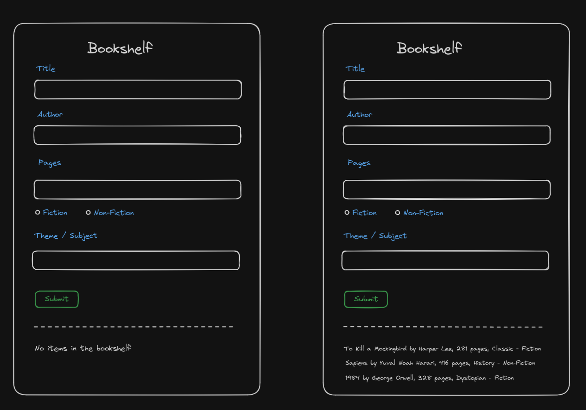

# Assignment: Bookshelf

## Introduction

In this course, we have learned how to utilize object-oriented and functional programming techniques to improve our code. However, we have yet to use these techniques to build an application. In this activity, we will combine our knowledge of front-end development with our newfound programming techniques to create a small application that simulates a bookshelf.

## Requirements

Create an application that enables a user to add books to a bookshelf using a form and displays the bookshelf at the bottom of the page.

There are two parts to this assignment:

1. The classes that model the behavior of a bookshelf.
2. The user interface that provides the user a way to interact with the bookshelf.

### Classes

Create the `Bookshelf` and `Book` classes. The `Bookshelf` class stores an array of `Book` objects. Create two subclasses of `Book` called `FictionBook` and `NonFictionBook`. The `Bookshelf` will store books of type `Book`, `FictionBook`, or `NonFictionBook`.

Implement the following in the `Bookshelf` class:

-   a `books` private instance variable that stores an array of `Book` objects
-   `addBook(book)`: adds a new `Book` object to the bookshelf.
-   `getBooksByAuthor(author)`: returns an array of `Book` objects written by the specified author.
-   `getLongestBook()`: returns the `Book` object with the most pages.
-   `getAveragePages()`: returns the average number of pages across all books on the bookshelf.
-   `getBookSummaries()`: returns an array of summaries for each book on the bookshelf, including the book's title, author, pages, and genre/topic.

Implement the following in the `Book` class:

-   `title`, `author`, and `pages` private instance variables.
-   a constructor that accepts a `title`, `author`, and `pages`.
-   getters for both `author` and `pages`.
-   **\***`getSummary()`: returns a string stating "[title] by [author], [page count] pages".

Implement the following in the `FictionBook` class:

-   should be a sub-class of `Book`.
-   `title`, `author`, `pages`, and `genre` private instance variables.
-   a constructor that accepts a `title`, `author`, `pages`, and `genre`.
-   **\***`getSummary()`: that returns a string stating "[title] by [author], [page count] pages, [genre] fiction".

Implement the following in the `NonFictionBook` class:

-   should be a sub-class of `Book`.
-   `title`, `author`, `pages`, and `topic` private instance variables.
-   a constructor that accepts a `title`, `author`, `pages`, and `topic`.
-   **\***`getSummary()`: returns a string stating "[title] by [author], [page count] pages, [topic] fiction".

Constraints:

-   Do not use loops (e.g., for, while) in your implementation (except for removing elements from the DOM).
-   You must use array higher-order functions (e.g. `filter()`, `reduce()`, `map()`) to implement the methods.
-   When adding a book to the bookshelf, the app should create a new instance of `FictionBook` or `NonFictionBook` and add this book to a `Bookshelf` instance using the `addBook()` method.
-   When retrieving book summaries, the app should retrieve this data from the `getBookSummaries()` method on `Bookshelf`.

> **Note**: For methods prefixed with \*, replace the placeholders within the [] with the respective instance variables.

### User Interface

Create a one-page website that displays book summaries and features a way to add a new book to the bookshelf. The UI should allow the user to choose between a fiction and nonfiction book and, depending on which option they choose, choose a theme or subject.

#### Wireframe

### Stretch Goals

If you have extra time, improve the application's UI by creating book cards with an image of each book within the card and its corresponding property information. Be creative!
